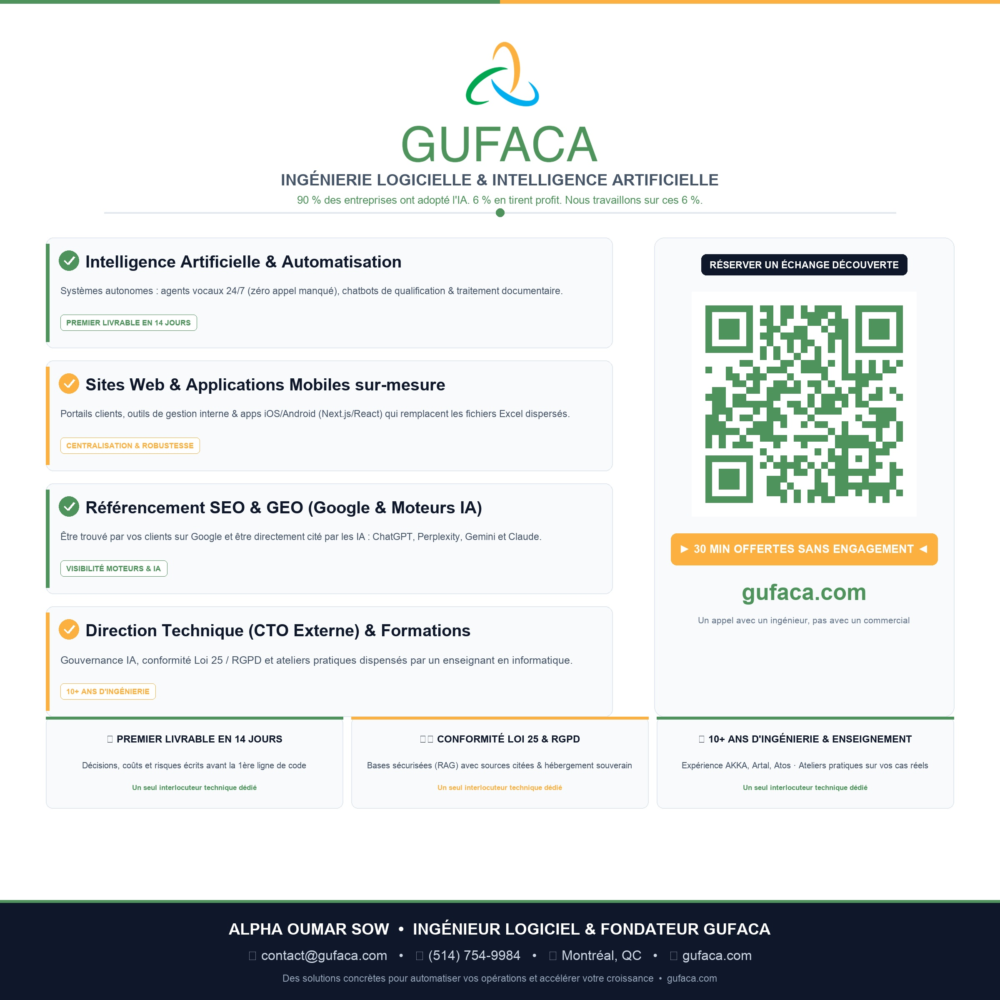
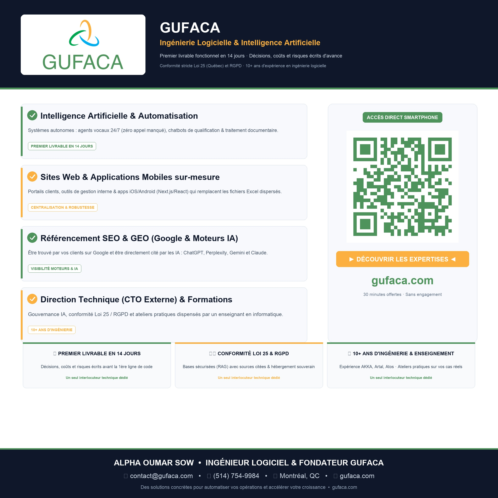
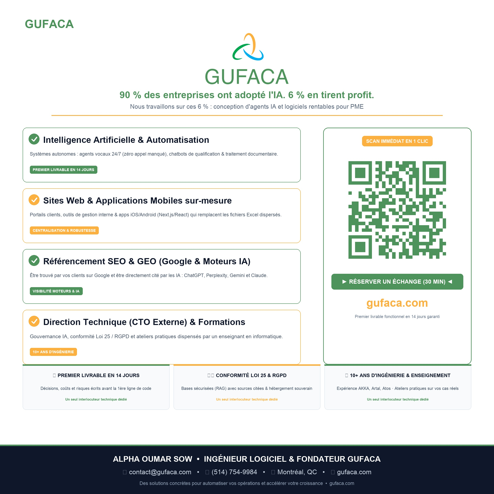

# 🚀 GUFACA — Kit d'Onboarding Réseau GR International

> **Générateur Multi-Styles d'Actifs Visuels Haute Définition & Profils Bilingues pour Membres de Réseaux d'Affaires**  
> *Conçu et propulsé par GUFACA ([gufaca.com](https://gufaca.com)) — Alpha Oumar Sow*

[](https://www.python.org/downloads/)
[](https://www.grinternational.ca/)
[]()
[]()
[](LICENSE)

---

## 💡 La Méthode la Plus Simple d'Utilisation

> **La manière la plus simple de l'utiliser, c'est de prendre le lien GitHub et de le donner à son IA et ça fonctionne.**

Il vous suffit de copier l'URL du dépôt GitHub :
```text
https://github.com/Gufaca/gufaca-network-onboarding-kit
```

Et de transmettre cette consigne à votre assistant d'intelligence artificielle préféré (Google Antigravity, ChatGPT, Claude, Cursor, Copilot) :

```text
Voici le kit d'onboarding : https://github.com/Gufaca/gufaca-network-onboarding-kit
Génère mes 3 affiches de table carrées, mes 3 bannières de profil, la présentation de mon entreprise et mon pitch d'une minute en français et en anglais avec les informations suivantes :
- Mon Nom : [Prénom Nom]
- Mon Entreprise : [Nom de l'entreprise]
- Ma Spécialité : [Sous-titre / Spécialité]
- Mon Site Web : [URL ou LinkedIn]
- Mes Coordonnées : [Courriel, Téléphone, Ville]
- Mon Logo et ma Photo en pièces jointes.
```

L'IA prend en charge l'exécution complète du script, l'extraction de vos couleurs de marque, la génération des visuels haute définition et la rédaction de vos documents textuels.

---

## 📋 Contexte : Optimisé pour GR International

Ce dépôt contient l'infrastructure logicielle et la compétence d'agent IA conçues pour propulser la visibilité des membres du réseau d'affaires **GR International** (ainsi que tout club d'entrepreneurs ou chambre de commerce).

Il permet à tout nouveau membre ou dirigeant de générer en quelques secondes un **kit de visibilité 360° complet** :
* 3 variantes graphiques d'affiches de table avec logo et QR code pour les déjeuners et rencontres d'affaires.
* 3 variantes graphiques de bannières de profil en haute définition (16:9) et au format miniature officiel de l'annuaire GR (300×180 px).
* Des profils d'annuaire bilingues (français et anglais) rédigés sur un ton humain, direct et sans jargon.
* Des formules de pitchs oraux percutants (pitch éclair 30s, pitch 60s, demande de recommandation ciblée).

---

## 🎨 Les Actifs Visuels Produits (Qualité Studio Graphique)

Le moteur extrait automatiquement la palette chromatique bicolore du logo du membre (couleur primaire et accent chaud/complémentaire) et applique un rendu d'agence : cartes avec ombres portées ambiantes (*ambient occlusion*), badges circulaires avec coches blanches `✓`, encarts de scan interactifs et rubans d'adhésion officiels.

### 1. 🖼️ 3 Styles de Bannières de Profil (16:9 HD 1376×768 & Miniature 300×180 px)

| Style | Nom | Description & Esthétique | Usage Recommandé |
| :--- | :--- | :--- | :--- |
| **Style 1** | **Executive Classic** | Fond sombre prestige (`#0B1124`), halo lumineux bicolore, photo portrait détourée à gauche (ratio 3:5), capsule logo blanche et typographie nette sans débordement. | Annuaire GR International, LinkedIn, En-têtes de proposition |
| **Style 2** | **Modern Circular** | Médaillon circulaire avec double anneau dynamique aux couleurs de marque, logo contrasté et puces stylisées. | Présentations d'équipe, signatures courriel, profils conférencier |
| **Style 3** | **Split Pro Contrast** | Découpage vertical asymétrique (35% portrait à gauche avec liseré bicolore, 65% contenu à droite sur fond ultra sombre). | Affichage mobile, bannières d'annuaires compacts |

#### Aperçu Visuel des 3 Styles de Bannières :

##### Style 1 — Executive Classic (16:9 HD) :


##### Style 2 — Modern Circular (16:9 HD) :


##### Style 3 — Split Pro Contrast (16:9 HD) :


---

### 2. 📄 3 Styles d'Affiches de Table au Format CARRÉ (2400×2400 px, 300 DPI)

Conçues spécialement au **format carré 1:1** haute définition (300 DPI), avec distribution aérée sur deux colonnes, barre de réassurance à 3 piliers (Livrable 14j, Loi 25 & RGPD, 10+ ans d'expérience) et grand QR Code scannable à distance :

| Style | Nom | Caractéristiques Visuelles & Contenu | Point Fort |
| :--- | :--- | :--- | :--- |
| **Style 1** | **Square Prestige Centered** *(Modèle Holistik Carré)* | Format carré 2400×2400, logo centré en majesté, sous-titre officiel, 4 modules de services complets (titre + description concrète + badge d'impact), encart QR code avec Call to Action et pied de page dark slate. | Équilibre parfait, clarté et prestige institutionnel épuré |
| **Style 2** | **Square Modern Dual-Block** | Grand bandeau supérieur bleu nuit (`#0F172A`) avec logo en boîte blanche en relief, 4 cartes d'expertises ergonomiques avec puces d'impact et grand module QR Code interactif. | Impact visuel fort, look moderne orienté tech et conseil |
| **Style 3** | **Square Bold Impact** *(Modèle Mamie Carré)* | Typographie extra large pour une lisibilité optimale à 3 mètres de distance, grand slogan de croissance, médaillons circulaires pleins et QR Code XXL. | Visibilité maximale à travers la salle lors du tour de table |

#### Aperçu Visuel des 3 Styles d'Affiches Carrées :

<div align="center">

##### Style 1 — Square Prestige Centered (2400×2400 px, 300 DPI)


##### Style 2 — Square Modern Dual-Block (2400×2400 px, 300 DPI)


##### Style 3 — Square Bold Impact (2400×2400 px, 300 DPI)


</div>

---

## 📝 3. Livrables Textuels Bilingues Générés Automatiquement (FR / EN)

À chaque génération, le script produit directement dans le dossier de sortie (`out-dir`) les documents textuels prêts à l'emploi au format Markdown :

### A. Présentation Complète de l'Entreprise (`presentation_entreprise_fr.md` & `presentation_entreprise_en.md`)
Synthèse exécutive structurée en 4 volets :
1. **Vision & Positionnement** : Accroche percutante issue de la réalité marché (ex: McKinsey 90% adoption / 6% rentabilité réelle).
2. **Les 4 Pôles d'Expertise** : Descriptions détaillées des solutions (IA 24/7, développement web Next.js/React, SEO/GEO génératif, CTO externe).
3. **Engagements & Méthodologie** : Garantie du premier livrable sous 14 jours, conformité stricte Loi 25 (Québec) & RGPD, et propriété exclusive du code client.
4. **Offre Découverte & Prise de Contact** : Consultation de diagnostic stratégique de 30 minutes sans engagement.

### B. Le Pitch d'Entreprise de 1 Minute Chrono (`pitch_1_minute_fr.md` & `pitch_1_minute_en.md`)
Conçu spécifiquement pour une prise de parole de 60 secondes en réunion d'affaires ou tour de table (~145 mots au rythme naturel) :

#### 🇫🇷 Pitch 1 Minute (Français) :
```text
Bonjour à tous, je suis Alpha Oumar Sow, ingénieur logiciel et fondateur de GUFACA à Montréal.

Saviez-vous que 90 % des entreprises ont commencé à intégrer l'intelligence artificielle, mais que seulement 6 % réussissent réellement à en tirer un profit mesurable ? Chez GUFACA, nous travaillons précisément avec ces 6 %.

La majorité des PME perdent entre 10 et 15 heures par semaine sur des tâches répétitives, la ressaisie manuelle de données ou des systèmes logiciels qui ne communiquent pas entre eux.

Notre rôle est d'éliminer ces freins : nous concevons des agents IA sur-mesure qui automatisent vos processus 24h sur 24, nous développons des applications web et mobiles ultra-rapides, et nous prenons en charge votre direction technique externalisée.

Notre promesse est concrète : un premier livrable fonctionnel en 14 jours chrono, avec une conformité totale à la Loi 25 québécoise et au RGPD.

J'offre avec grand plaisir à chaque membre un diagnostic stratégique de 30 minutes sans engagement directement avec moi pour identifier vos gains de temps immédiats.

Visitez gufaca.com ou venez échanger avec moi à la pause !
```

#### 🇬🇧 Pitch 1 Minute (English) :
```text
Hello everyone, I am Alpha Oumar Sow, software engineer and founder of GUFACA in Montreal.

Did you know that 90% of businesses have started adopting artificial intelligence, yet only 6% are generating measurable bottom-line profit from it? At GUFACA, we work specifically with that 6%.

Most growing companies lose 10 to 15 hours every week on repetitive tasks, manual data entry, and outdated software systems that do not talk to each other.

Our mission is to eliminate those bottlenecks: we engineer custom 24/7 AI agents that automate your daily operations, develop high-performance web and mobile applications, and provide fractional CTO technical leadership.

Our commitment is concrete: we deploy your first functional deliverable in 14 business days, with complete compliance with Quebec's Law 25 and GDPR privacy standards.

I am pleased to offer every member a complimentary 30-minute strategic diagnostic session directly with me to identify your immediate ROI and efficiency gains.

Visit gufaca.com or let's connect right after the meeting!
```

---

## 🛠️ Guide d'Installation Pas-à-Pas

### 1. Prérequis Système
* **Python 3.9** ou supérieur installé ([python.org](https://www.python.org/downloads/)).
* Git installé sur votre poste.

### 2. Cloner le Dépôt
```bash
git clone https://github.com/Gufaca/gufaca-network-onboarding-kit.git
cd gufaca-network-onboarding-kit
```

### 3. Créer et Activer un Environnement Virtuel (Recommandé)

**Sur macOS et Linux :**
```bash
python3 -m venv venv
source venv/bin/activate
```

**Sur Windows :**
```bash
python -m venv venv
venv\Scripts\activate
```

### 4. Installer les Dépendances
```bash
pip install -r requirements.txt
```

*(Optionnel pour les tests automatisés de décodage optique : `pip install opencv-python`)*

---

## 🧪 Comment Tester le Projet (Tests Unitaires & d'Intégration)

Le projet intègre une suite de validation complète combinant tests unitaires, tests d'intégration de bout en bout et vérification optique des QR codes.

### 1. Exécution de la Suite Complète (Recommandé)
```bash
python3 test_kit.py
```

### 2. Exécution des Tests Unitaires & d'Intégration via `unittest`
Pour lancer l'ensemble des suites avec le framework standard Python :
```bash
# Lancer tous les tests découverts
python3 -m unittest discover tests

# Lancer uniquement les tests unitaires (palette, typo, textes, QR)
python3 -m unittest tests/test_unit.py

# Lancer uniquement les tests d'intégration (pipeline complet & décodage optique)
python3 -m unittest tests/test_integration.py
```

**Sortie attendue :**
```text
==================================================================
  Démarrage des tests officiels GUFACA (Sortie: outputs_v3)
  Affiches CARRÉES 2400x2400 (300 DPI) & Bannières HD
==================================================================
✔ Test 1 : Actifs sources (photo + logo) validés.
✔ Test 2 : Couleurs dominantes extraites : Primaire=(78, 147, 91), Secondaire=(251, 176, 64)

=======================================================
  GÉNÉRATION VISUELLE OFFICIELLE GUFACA (gufaca.com)
  Format Affiches : 2400x2400 px (Carré 300 DPI)
  Format Bannières : 16:9 HD (1376x768 px) & 300x180 px
  Livrables Textuels : Présentations & Pitchs 1 min (FR/EN)
=======================================================

✔ Bannière Style 1 (Executive Classic) générée
✔ Bannière Style 2 (Modern Circular) générée
✔ Bannière Style 3 (Split Pro) générée
✔ Affiche Carrée Style 1 (Prestige Centered) générée
✔ Affiche Carrée Style 2 (Header Card) générée
✔ Affiche Carrée Style 3 (Asymmetric Bold) générée
✔ Documents textuels générés (Présentations, Pitchs 1 min, Profils FR/EN)

✔ Test 4 : Les 3 styles de bannières (HD et 300x180 px) sont 100% validés.
✔ Test 5 : Les 3 styles d'affiches de table CARRÉES (2400x2400 px) sont 100% validés.
✔ Test 6 : QR Code décodé avec succès dans les 3 affiches -> https://gufaca.com
✔ Test 7 : Les 6 documents textuels (Présentations, Pitchs 1 min, Profils FR/EN) sont 100% validés.

==================================================================
  TOUS LES TESTS SONT VALIDES AVEC SUCCÈS (100%)
==================================================================
```

Les images produites se trouvent dans `assets/outputs/`.

---

## 🚀 Guide d'Utilisation : Générer Vos Propres Actifs

### Mode Démonstration Rapide
Génère tous les visuels avec les éléments graphiques et coordonnées par défaut de GUFACA :
```bash
python3 generate_member_assets.py --demo
```

### Personnalisation Complète pour un Membre ou une Entreprise
Vous pouvez passer l'ensemble de vos paramètres en ligne de commande :

```bash
python3 generate_member_assets.py \
  --name "Jean-François Tremblay" \
  --company "Tremblay Solutions" \
  --subtitle "Comptabilité Stratégique & Conseil PME" \
  --headline "Optimisation Fiscale & Conseil PME" \
  --website "https://gufaca.com" \
  --email "jf@tremblaysolutions.ca" \
  --phone "(514) 555-0199" \
  --city "Montréal, QC" \
  --network "GR INTERNATIONAL" \
  --logo "chemin/vers/mon_logo.png" \
  --photo "chemin/vers/ma_photo.png" \
  --out-dir "mes_visuels"
```

### Tableau des Options CLI

| Paramètre | Description | Valeur par défaut |
| :--- | :--- | :--- |
| `--name` | Nom complet du dirigeant ou représentant | `Alpha Oumar Sow` |
| `--company` | Nom de l'entreprise ou marque | `GUFACA` |
| `--subtitle` | Spécialité ou sous-titre officiel | `Ingénierie Technologique & Intelligence Artificielle` |
| `--headline` | Accroche concise pour les bannières | `Ingénierie Technologique & IA` |
| `--website` | URL officielle vers laquelle pointe le QR Code | `https://gufaca.com` |
| `--email` | Courriel professionnel affiché en pied de page | `alpha@gufaca.com` |
| `--phone` | Numéro de téléphone direct | `(514) 754-9984` |
| `--city` | Ville et province d'opération | `Montréal, QC` |
| `--network` | Nom du réseau d'affaires partenaire | `GR INTERNATIONAL` |
| `--logo` | Chemin vers le logo haute résolution (PNG transparent recommandé) | `assets/sample_logo.png` |
| `--photo` | Chemin vers la photo portrait professionnelle | `assets/sample_photo.png` |
| `--out-dir` | Dossier de sortie des fichiers générés | `assets/outputs/` |

---

## 🖨️ Conseils d'Impression & d'Affichage

1. **Affiches de table au format CARRÉ (Chevalets 2400×2400 px, 300 DPI) :**
   * Format carré 1:1 optimisé pour tirage photo 8×8 pouces ou 20×20 cm en haute définition.
   * Imprimer sur papier couché mat ou semi-brillant (minimum 200 g/m²).
   * Insérer dans un cadre ou présentoir de table carré en acrylique transparent (chevalet en T ou en L).
2. **Miniatures Annuaire (300×180 px) :**
   * Dimension exacte exigée par la plateforme d'annuaire des membres de GR International.
3. **Bannières 16:9 HD (1376×768 px) :**
   * Parfaites pour LinkedIn, signatures HTML, fiches de présentation client et diapositives.

---

## 🌐 Membres Sans Site Web : Accompagnement GUFACA

Pour les nouveaux membres ne disposant pas encore d'un site internet moderne ou dont le site actuel n'est pas optimisé mobile :
* Ils bénéficient d'un **tarif préférentiel exclusif** auprès de **GUFACA** ([gufaca.com](https://gufaca.com)) pour la conception de leur vitrine moderne, portail métier ou application mobile.
* En attendant la mise en ligne, le QR code de leurs affiches peut être directement relié à leur profil professionnel LinkedIn ou à leur fiche contact vCard.

---

## 📁 Architecture du Dépôt

```text
gufaca-network-onboarding-kit/
├── README.md                      # Documentation complète (Installation, Usage, Architecture)
├── SKILL.md                       # Spécification de la compétence Antigravity AI Agent
├── requirements.txt               # Dépendances Python (pillow, qrcode, opencv-python)
├── LICENSE                        # Licence libre MIT
├── .gitignore                     # Fichiers exclus du suivi git
├── generate_member_assets.py      # Moteur multi-styles & générateur textuel bilingue
├── test_kit.py                    # Suite complète de validation avec décodage optique QR
├── tests/                         # Suite de tests structurée
│   ├── __init__.py
│   ├── test_unit.py               # Tests unitaires (palette, typographie, QR, livrables)
│   └── test_integration.py       # Tests d'intégration de bout en bout (dimensions & QR)
├── templates/                     # Gabarits de documents textuels
│   ├── company_presentation_fr.md # Modèle de présentation d'entreprise (FR)
│   ├── company_presentation_en.md # Modèle de présentation d'entreprise (EN)
│   ├── pitch_1_minute_fr.md       # Modèle de pitch 1 minute (FR)
│   ├── pitch_1_minute_en.md       # Modèle de pitch 1 minute (EN)
│   ├── profile_template_fr.md     # Modèle de profil d'annuaire (FR)
│   ├── profile_template_en.md     # Modèle de profil d'annuaire (EN)
│   └── pitch_templates.md         # Pitchs oraux 30s, 60s et demandes de recommandations
└── assets/
    ├── sample_logo.png            # Logo de démonstration GUFACA
    ├── sample_photo.png           # Photo de démonstration du dirigeant
    ├── examples/                  # Exemples de démonstration suivis sur GitHub
    └── outputs/                   # Actifs générés localement lors des exécutions
```

---

## 🆘 Support Direct & Assistance Personnalisée

Pour toute assistance technique, adaptation de gabarits ou intégration sur-mesure dans votre écosystème d'entreprise :

* 👤 **Alpha Oumar Sow** — Fondateur & Ingénieur IA, GUFACA
* 📞 Téléphone : **(514) 754-9984**
* ✉️ Courriel : **alpha@gufaca.com**
* 📍 Bureau : **Montréal (Québec), Canada**
* 🌐 Site web officiel : **[gufaca.com](https://gufaca.com)**

---

## 📄 Licence
Ce projet est distribué sous licence libre **MIT**. Vous êtes libre de l'utiliser, l'adapter et le redistribuer pour vos membres et vos projets clients.
